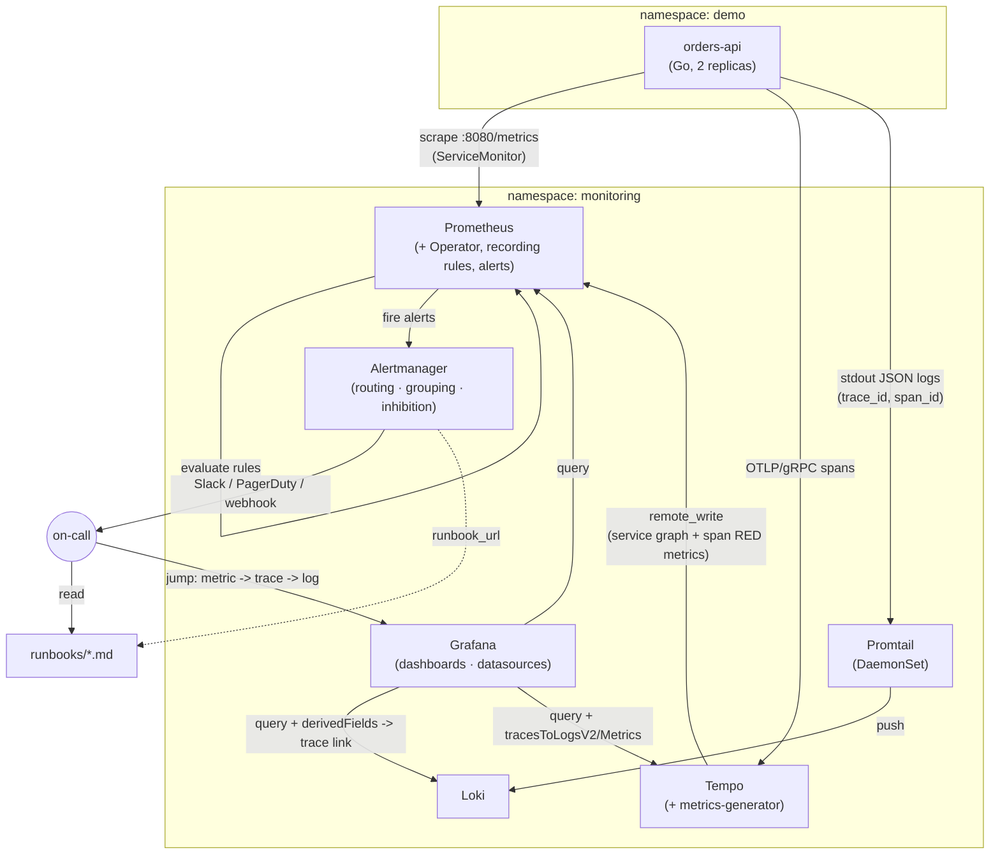

# k8s-observability-stack

**A Kubernetes observability stack built the way an SRE would actually run one: metrics, logs
and traces correlated end to end, SLOs with multi-window burn-rate paging, dashboards as code,
and runbooks linked straight from every alert.**

[](stack/prometheus)
[](stack/grafana)
[](stack/loki)
[](stack/tempo)
[](app/k8s)
[](#license)

---

## Why this exists

You cannot operate what you cannot see, and "I installed Prometheus" is not the same claim as
"I can tell you, in thirty seconds, whether this service is in trouble and why". This repo is
the second claim, built end to end around one idea borrowed from Google's SRE practice: **alert
on symptoms and error budgets, not on CPU.** A CPU-percentage alert tells you a number moved. A
burn-rate alert tells you that at the current rate of badness, you will have broken your promise
to users in a specific, calculable number of hours — and it tells you that *fast enough to act*
and *resolves fast enough to trust*, which is the entire point of the multi-window design in
[`stack/prometheus/rules/slo-alerts.yaml`](stack/prometheus/rules/slo-alerts.yaml).

Everything else here exists in service of that one alert firing correctly: a demo app that emits
real RED + business metrics, traces and trace-correlated logs; a stack that wires all three
together; and fault-injection endpoints so you can *prove* the whole chain works on demand
instead of waiting for a real 3am incident to find out.

## Architecture



## The three pillars

| Pillar | Tool | Collector | What it answers |
|---|---|---|---|
| **Metrics** | Prometheus (+ Operator) | ServiceMonitor scraping `orders-api:8080/metrics` every 15s | "Is it broken, and how badly, right now and over time?" |
| **Logs** | Loki | Promtail DaemonSet, parsing structured JSON off stdout | "What exactly happened, in this specific request's own words?" |
| **Traces** | Tempo | OTLP/gRPC from the app's OpenTelemetry SDK | "Where did the time go, across every hop this request made?" |

No pillar alone is enough: a metric tells you *that* p99 jumped, a trace tells you *which span*
in *which request* caused it, and the log line for that exact trace tells you *why* in the
application's own words — see `docs/architecture.md` for the full data-flow story and
`LEARN.md` for the conceptual grounding behind each pillar.

## Key capabilities

| Capability | Implementation | File |
|---|---|---|
| Multi-window multi-burn-rate SLO alerting | Four-rung ladder (14.4x/6x/3x/1x), derived from a paging policy, not copied from a blog post | [`stack/prometheus/rules/slo-alerts.yaml`](stack/prometheus/rules/slo-alerts.yaml) |
| Dashboards as code | Grafana JSON provisioned via a labelled-ConfigMap sidecar, zero click-ops | [`stack/grafana/dashboards/json/`](stack/grafana/dashboards/json/) |
| Metric ↔ trace ↔ log correlation | `trace_id` in every log line; Loki `derivedFields` ↔ Tempo `tracesToLogsV2` | [`stack/grafana/datasources/datasources.yaml`](stack/grafana/datasources/datasources.yaml) |
| Runbook-linked alerts | Every alert rule carries a `runbook_url` annotation pointing at a specific file | [`runbooks/`](runbooks/) |
| Alert inhibition & grouping | Critical SLO rungs suppress warning rungs for the same incident; `group_by` collapses rungs into one page | [`stack/alertmanager/alertmanager-config.yaml`](stack/alertmanager/alertmanager-config.yaml) |
| RED + USE methodology | Rate/Errors/Duration on the app, Utilization/Saturation/Errors on nodes & pods | [`stack/prometheus/rules/recording-rules.yaml`](stack/prometheus/rules/recording-rules.yaml) |
| Business metrics alongside infra metrics | `orders_processed_total`, `order_value_euros`, `queue_depth` — "is the business healthy", not just "is the CPU fine" | [`app/main.go`](app/main.go) |
| Trace-derived service graph & RED metrics | Tempo's metrics-generator turns spans into Prometheus series — RED metrics for services with no client library at all | [`stack/tempo/values.yaml`](stack/tempo/values.yaml) |
| Fault injection for verification | `/chaos/{latency,errors,leak,cpu}` endpoints so every alert/dashboard can be demonstrated on demand | [`app/main.go`](app/main.go), [`scripts/trigger-incident`](scripts/) |

## Quickstart

**Requirements**: Docker Desktop (or another minikube driver), `kubectl`, `helm`, `minikube`.
Give minikube real headroom — this stack plus the demo app is comfortable on 4 CPUs / 8GB RAM,
tight below that.

```powershell
# PowerShell
minikube start --cpus=4 --memory=8192
.\scripts\preflight.ps1        # checks tool versions, cluster resources
.\scripts\cluster-up.ps1        # creates namespaces
.\scripts\install-stack.ps1     # Prometheus + Grafana + Loki + Tempo + Alertmanager
.\scripts\deploy-app.ps1        # builds and deploys orders-api into minikube's docker daemon
.\scripts\port-forward.ps1      # forwards Grafana/Prometheus/Alertmanager to localhost
```

```bash
# bash
minikube start --cpus=4 --memory=8192
./scripts/preflight.sh
./scripts/cluster-up.sh
./scripts/install-stack.sh
./scripts/deploy-app.sh
./scripts/port-forward.sh
```

Open Grafana at **http://localhost:3000** (credentials printed at the end of
`install-stack` — see [`stack/prometheus/values.yaml`](stack/prometheus/values.yaml)'s
`grafana.admin.existingSecret`). Start on the **orders-api / RED Metrics** dashboard.

## Live demo: trigger an incident

The whole point of fault injection is proving the alerting chain works without waiting for a
real outage:

```powershell
.\scripts\trigger-incident.ps1   # arms chaos + runs load/k6/failure-scenario.js against it
```
```bash
./scripts/trigger-incident.sh
```

The script tells you, in order, what to watch and what to screenshot: the RED dashboard's error
rate climbing, the SLO dashboard's burn-rate ladder crossing the 14.4x line, the `ErrorBudgetBurn`
alert turning red in Alertmanager, a slow/failed trace waterfall in Tempo, and that trace's
correlated log line in Loki (click the `trace_id` link). Run `scripts/heal` to disarm chaos and
watch the short window reset the alert within minutes — see `docs/slo-guide.md` section 7 for
exactly why it resolves in minutes rather than the full long-window duration.

## Repository layout

```
app/                   orders-api — the instrumented Go service and its k8s manifests
stack/                 Helm values + PrometheusRules + Grafana provisioning for the whole stack
  prometheus/          values.yaml, recording rules, app/infra/SLO alerts
  loki/ tempo/          log + trace backends
  grafana/              datasources (the correlation config) + dashboards as code
  alertmanager/         routing tree, inhibition, Slack template
slo/                   declarative SLO definitions, error-budget policy, Sloth equivalents
runbooks/              one file per alert: what to check, in what order, how to confirm the fix
docs/                  architecture, SLO derivation, PromQL/LogQL cookbooks, troubleshooting
load/                  k6 scripts (steady / spike / failure) + a Kubernetes Job to run them
scripts/               cluster lifecycle, install, deploy, demo (trigger-incident/heal), teardown
LEARN.md               the concepts, from first principles, with 15+ interview Q&As
```

## Dashboards

| Dashboard | UID | Shows |
|---|---|---|
| [orders-api / RED Metrics](stack/grafana/dashboards/json/app-red-metrics.json) | `obs-app-red` | Request rate, error %, p50/p90/p99, saturation, status mix, top slow routes |
| [orders-api / SLO Error Budget](stack/grafana/dashboards/json/slo-error-budget.json) | `obs-slo-budget` | Current SLI, remaining budget, burn-rate ladder, 30-day compliance |
| [Kubernetes Cluster Overview](stack/grafana/dashboards/json/kubernetes-cluster.json) | `obs-k8s-cluster` | Node CPU/mem/disk, pod phases, restarts, per-namespace usage |
| [Logs Explorer](stack/grafana/dashboards/json/logs-explorer.json) | `obs-logs-explorer` | Log volume by level, error rate, live tail, top error messages |

## Alerts

| Alert | Severity | Meaning | Runbook |
|---|---|---|---|
| `ErrorBudgetBurn` (x4 rungs, x2 SLOs) | critical / warning | Burning the availability or latency error budget 14.4x/6x/3x/1x faster than sustainable | [ErrorBudgetBurn.md](runbooks/ErrorBudgetBurn.md) |
| `HighErrorRate` | warning | A single route's 5m error ratio exceeds 5% | [HighErrorRate.md](runbooks/HighErrorRate.md) |
| `HighLatencyP99` | warning | p99 latency exceeds 500ms | [HighLatencyP99.md](runbooks/HighLatencyP99.md) |
| `PodCrashLooping` | critical | A pod restarted more than twice in 15m | [PodCrashLooping.md](runbooks/PodCrashLooping.md) |
| `PodNotReady` | warning | A pod has failed readiness for 10m | [PodCrashLooping.md](runbooks/PodCrashLooping.md) |
| `QueueDepthGrowing` | warning | The processing backlog is trending up — a leading indicator | [ErrorBudgetBurn.md](runbooks/ErrorBudgetBurn.md) |
| `NoTrafficReceived` | critical | No requests seen for 10m — the degenerate case ratio-based alerts can't see | [TargetDown.md](runbooks/TargetDown.md) |
| `NodeMemoryPressure` | warning | Node available memory below 10% | [NodeMemoryPressure.md](runbooks/NodeMemoryPressure.md) |
| `NodeDiskSpaceLow` | warning | Disk projected to fill within 4h (`predict_linear`) | [README.md](runbooks/README.md) |
| `KubePodNotReady` | warning | Any pod stuck Pending/Unknown for 15m | [PodCrashLooping.md](runbooks/PodCrashLooping.md) |
| `ContainerOOMKilled` | critical | A container was killed by the OOM killer | [ContainerOOMKilled.md](runbooks/ContainerOOMKilled.md) |
| `HPAMaxedOut` | warning | An HPA pinned at max replicas, still wanting more | [README.md](runbooks/README.md) |
| `PVCNearlyFull` | warning | A PersistentVolumeClaim below 10% free | [PVCNearlyFull.md](runbooks/PVCNearlyFull.md) |
| `CertificateExpiringSoon` | warning | A TLS cert expires within 14 days | [README.md](runbooks/README.md) |
| `TargetDown` | critical | Prometheus cannot scrape a target at all | [TargetDown.md](runbooks/TargetDown.md) |

## Skills demonstrated

Prometheus · PromQL · Grafana · Loki · LogQL · Tempo · OpenTelemetry (OTLP, context propagation,
span attributes) · Kubernetes (Deployments, Services, ServiceMonitors, PodDisruptionBudgets,
PodSecurity, topology spread) · Helm · the Prometheus Operator & CRDs · Alertmanager (routing,
grouping, inhibition, templating) · SLO/SLI design · error budgets & multi-window multi-burn-rate
alerting (Google SRE Workbook method) · dashboards-as-code · Go (structured logging with
`log/slog`, Prometheus client library, graceful shutdown) · k6 load testing · chaos/fault
injection · GitOps-style provisioning (sidecar-driven ConfigMap discovery) · incident response
runbooks · minikube resource planning for multi-component local clusters.

## What I'd do next in production

- **Thanos or Grafana Mimir** for long-term, horizontally-scalable metric storage — this repo's
  7-day local retention is a laptop constraint, not a design goal (see `docs/architecture.md`).
- **An OTel Collector pipeline** in front of Tempo, doing tail-based sampling (keep 100% of
  errors and slow traces, a few percent of the rest) instead of this demo's head-sampled 100%.
- **Exemplars wired end to end**: the Prometheus datasource is already configured for them
  (`stack/grafana/datasources/datasources.yaml`); the app would need to attach the active
  trace_id to each histogram observation via `prometheus/client_golang`'s exemplar API.
- **Pyroscope continuous profiling**, correlated the same way traces are — CPU/memory flame
  graphs reachable from the same trace click-through.
- **Synthetic monitoring** (Blackbox exporter or Grafana Synthetic Monitoring) as a client-side
  cross-check against the server-side SLI's blind spot (see `docs/slo-guide.md`'s
  "invisible-failure problem").
- **A real on-call rotation in PagerDuty/Opsgenie** instead of the placeholder integration key in
  `stack/alertmanager/alertmanager-config.yaml`.
- **Cardinality governance**: `mimirtool`/`promtool` cardinality checks in CI, so a label change
  that would 10x the series count is caught in review, not three weeks into a production incident.

## License

MIT — see [`LICENSE`](LICENSE).

---

Built by **Ahmed Fakhfakh** — DevOps / SRE. [GitHub](https://github.com/fakhfakhahmed) ·
[LinkedIn demo walkthrough: see `docs/screenshots/README.md` for the shot list behind the post].
