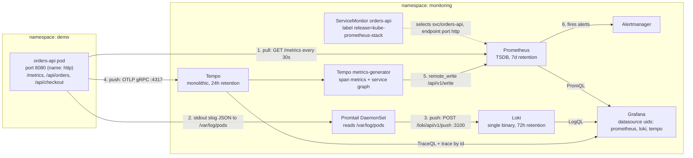
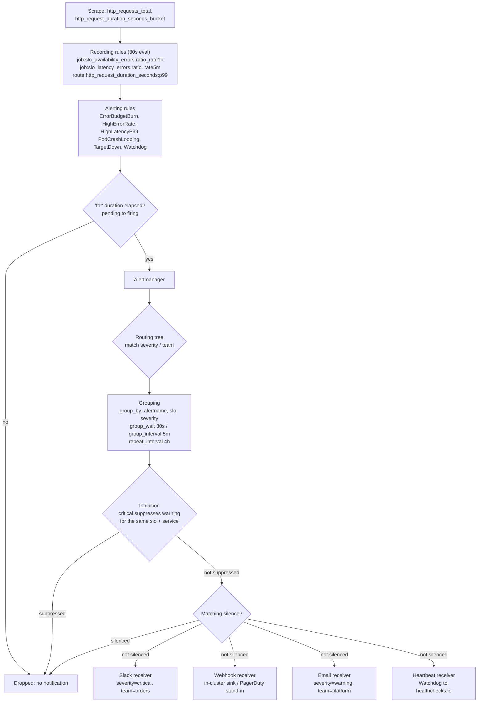
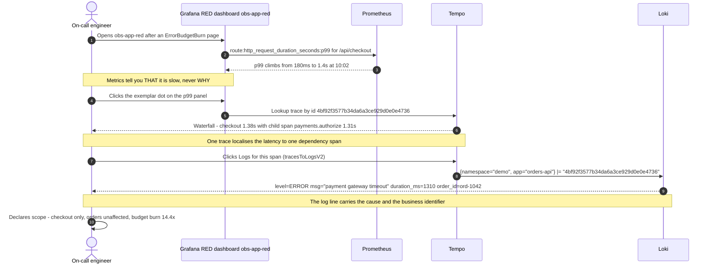

# Architecture

This document explains what runs, why it runs, how the three telemetry signals reach
Grafana, and which alternatives were evaluated and rejected. It is the design record for
`k8s-observability-stack`.

The stack is deliberately **single-cluster, single-tenant, laptop-sized**. Every component
was chosen so the whole thing fits inside `minikube start --cpus=4 --memory=8192
--disk-size=40g` with headroom left for the demo application and a k6 load-test Job. That
constraint drives most of the decisions below.

---

## 1. The three pillars and how data flows



### Reading the diagram

**Metrics are pulled; logs and traces are pushed.** That asymmetry is the single most
important thing to internalise about this stack, because it determines how each pipeline
fails.

1. **Metrics (pull).** The `orders-api` Deployment exposes a Prometheus text endpoint on
   `:8080/metrics` — the *same* port that serves traffic, not a sidecar port. A
   `ServiceMonitor` in namespace `monitoring` selects `svc/orders-api` by label and names
   the Service port (`http`). The Prometheus Operator renders that ServiceMonitor into a
   `scrape_config` inside Prometheus's generated configuration Secret. Prometheus then
   scrapes every 30s and the resulting series carry `job="orders-api"`. If the
   ServiceMonitor is wrong, nothing errors loudly — the target simply never appears. That
   silent-failure mode is the #1 entry in [`troubleshooting.md`](troubleshooting.md).
2. **Logs (push, agent-side).** The app writes structured `slog` JSON to stdout. The
   container runtime writes that to a file under `/var/log/pods/...`. Promtail runs as a
   DaemonSet with that path host-mounted, tails the files, attaches a small, fixed set of
   Kubernetes labels, and pushes batches to Loki. Promtail — not Loki — owns the tailing
   position file, so a Promtail restart is what causes gaps or duplicates, never a Loki
   restart.
3. **Traces (push, app-side).** The OpenTelemetry SDK inside `orders-api` batches spans
   and exports them over **OTLP gRPC** to `tempo.monitoring.svc.cluster.local:4317`. This
   is the only pipeline where the application itself holds a long-lived outbound
   connection to the observability stack. If Tempo is down, the SDK drops spans after its
   queue fills — by design, telemetry must never block order processing.
4. **Derived metrics (push, Tempo-side).** Tempo's `metrics-generator` consumes the span
   stream and emits span metrics and a service graph, remote-written into Prometheus. This
   gives RED numbers for services that were never instrumented with a Prometheus client.
   **The dashboards in this repo deliberately do not depend on these series** — the RED
   dashboard is built on the app's own `http_requests_total` and
   `http_request_duration_seconds_bucket`. Span metrics are sampled-trace-derived and
   therefore a second-class source of truth for an SLO. They are enabled here to prove the
   mechanism and to populate the service-graph view.

All three stores are read by Grafana through three fixed datasource UIDs — `prometheus`,
`loki`, `tempo` — which are hard-coded in the provisioned dashboard JSON. Fixed UIDs are
what make "dashboards as code" survive a reinstall; if you let Grafana generate random
UIDs, every dashboard breaks the next time you `helm uninstall`.

### What crosses a namespace boundary

| Hop | From | To | Protocol | Crosses namespaces |
|---|---|---|---|---|
| Scrape | Prometheus (`monitoring`) | `orders-api` pod IP (`demo`) | HTTP/1.1 | yes |
| Log tail | Promtail (host path) | n/a | file | no (node-local) |
| Log push | Promtail (`monitoring`) | Loki (`monitoring`) | HTTP/1.1 | no |
| Trace export | `orders-api` (`demo`) | Tempo (`monitoring`) | gRPC/HTTP2 | yes |
| Remote write | Tempo (`monitoring`) | Prometheus (`monitoring`) | HTTP/1.1 | no |

The two cross-namespace hops are the ones a `NetworkPolicy` will break first. On a default
minikube there is no CNI policy enforcement, so this works out of the box; on a real
cluster you need explicit allow rules in both directions.

---

## 2. The alerting path



### Reading the diagram

The alerting path has **two independent evaluation loops**, and conflating them is a
classic source of confusion.

**Loop 1 — Prometheus (every `evaluation_interval`, 30s here).** Prometheus evaluates
recording rules first, then alerting rules that reference them. Recording rules exist for
three reasons: the SLO ratio expressions are expensive, they are reused by both dashboards
and alerts, and the multi-window burn-rate ladder needs seven pre-computed windows per SLO
(`ratio_rate5m` through `ratio_rate3d`). Evaluating those inline in eight alert rules would
re-scan the same raw counters dozens of times per minute.

Rule-group ordering matters: within a group, rules are evaluated **sequentially**, so a
recording rule can be consumed by a later rule in the same group in the same evaluation.
Across groups, evaluation is concurrent, so an alert rule in `slo.availability.rules` that
reads a recording rule from `recording-rules.yaml` is reading the value from the *previous*
evaluation cycle. At a 30s interval that is irrelevant for a 1h burn window; it would
matter if you tried to alert on a 1m window.

An alert that evaluates true enters **pending**, and only becomes **firing** after its
`for:` duration. `for:` is a debounce against a single bad scrape, not a substitute for a
proper window — the multi-window burn-rate design already provides the real debounce, which
is why the `ErrorBudgetBurn` rules use short `for:` values (2m on the fast rungs).

**Loop 2 — Alertmanager (continuous, driven by incoming pushes).** Prometheus pushes the
full set of currently-firing alerts to Alertmanager every evaluation cycle; Alertmanager
expires an alert when it stops being pushed (`resolve_timeout`). Alertmanager then applies,
in this order:

| Stage | Config key | What it does here |
|---|---|---|
| Routing | `route` / `routes` | Match `severity` and `team`; critical+orders to Slack and webhook, warning to email, Watchdog to its own route |
| Grouping | `group_by`, `group_wait`, `group_interval`, `repeat_interval` | All four `ErrorBudgetBurn` rungs for the same `slo` arrive as ONE notification, not four |
| Inhibition | `inhibit_rules` | A firing `critical` `ErrorBudgetBurn` suppresses the `warning` rungs for the same `slo` + `service` |
| Silencing | runtime objects, not config | An operator mutes a known-bad matcher set for a bounded window |
| Notification | `receivers` | Slack / webhook / email / heartbeat |

Grouping is the single highest-leverage knob for signal quality. Because the repo uses one
alert *name* — `ErrorBudgetBurn` — distinguished by labels (`slo`, `severity`,
`long_window`, `short_window`, `burn_rate`, `page`), a genuine outage that trips the 14.4x,
6x and 3x rungs simultaneously produces **one** grouped notification containing three
entries, not three pages. Inhibition then removes the 3x warning entirely so the on-call
sees only the actionable critical.

`Watchdog` is the inverse of every other rule: an always-true expression whose *absence* is
the signal. It routes to its own receiver with a short `repeat_interval` and no grouping,
so it can drive an external dead-man's switch. See
[`alerting-philosophy.md`](alerting-philosophy.md) for the full rationale and the
healthchecks.io wiring.

---

## 3. The correlation flow: metric to trace to log



### The mechanism underneath: derived fields and trace-to-logs

Nothing in that sequence is magic, and none of it works unless three independent things
agree on the **same trace id string**.

**(a) The application emits the trace id into the log line.** The `slog` handler pulls the
active span context out of `context.Context` on every request and writes `trace_id` and
`span_id` as top-level JSON fields:

```json
{"time":"2026-10-17T10:00:00.123Z","level":"INFO","msg":"order processed",
 "trace_id":"4bf92f3577b34da6a3ce929d0e0e4736","span_id":"00f067aa0ba902b7",
 "route":"/api/orders","status":200,"duration_ms":41.2,"order_id":"ord-1042"}
```

If a log line is written outside a request context, it has no `trace_id` and is simply not
reachable by correlation. That is acceptable; it is also why startup and shutdown logs
never appear in a trace-filtered view.

**(b) Loki keeps `trace_id` in the line, never as a label.** Promtail attaches only
`namespace`, `pod`, `container`, `app`, `level`, `stream`. A trace id is unique per
request — promoting it to a label would create one Loki stream per request, and each stream
owns its own chunk. That is the cardinality explosion described in
[`logql-cookbook.md`](logql-cookbook.md). Correlation does not need it to be a label,
because Loki's line filter `|=` over a narrow time range is a fast substring scan.

**(c) Grafana's Loki datasource declares a `derivedFields` entry.** Provisioned alongside
the datasource:

```yaml
# stack/grafana/datasources — Loki datasource, derivedFields section
derivedFields:
  - name: TraceID
    # Matches the trace_id value inside the raw JSON log line.
    matcherRegex: '"trace_id"\s*:\s*"([a-f0-9]{32})"'
    # The capture group becomes ${__value.raw}; for Tempo the URL IS the trace id.
    url: '${__value.raw}'
    datasourceUid: tempo
```

Grafana applies `matcherRegex` to every rendered log line in Explore and in the Logs panel.
The **first capture group** becomes a clickable link. The regex is matched against the raw
line text, so it must survive whatever the line actually looks like — this is why the
pattern allows optional whitespace around the colon and pins the value to 32 lowercase hex
characters (the W3C Trace Context format). A regex that assumes `"trace_id":"` with no
space is the most common reason the link silently does not render.

**(d) Grafana's Tempo datasource declares `tracesToLogsV2` for the reverse direction.**

```yaml
# stack/grafana/datasources — Tempo datasource, trace-to-logs section
tracesToLogsV2:
  datasourceUid: loki
  spanStartTimeShift: '-5m'
  spanEndTimeShift: '5m'
  filterByTraceID: true
  filterBySpanID: false
  tags:
    - key: 'service.namespace'
      value: 'namespace'
  # Note the doubled $$ — Helm/Grafana provisioning would otherwise eat the single $.
  customQuery: true
  query: '{namespace="demo", app="orders-api"} |= "$${__trace.traceId}"'
```

Three details earn their keep here. `spanStartTimeShift` / `spanEndTimeShift` widen the
Loki query window around the span — without them you query an instant and find nothing,
because log timestamps and span timestamps never match to the millisecond. `tags` maps a
span resource attribute onto a Loki label so the generated query still starts with a label
selector instead of scanning the whole index. And the doubled `$$` is a provisioning-time
escape: Grafana's config loader performs environment-variable substitution on datasource
YAML, so a single `$` would be consumed before Grafana ever sees the template.

**(e) Exemplars close the metrics-to-traces loop.** The histogram
`http_request_duration_seconds_bucket` is exported with exemplars attached — each carrying
the `trace_id` of one request that landed in that bucket. Prometheus must be started with
the exemplar storage enabled, and the Prometheus datasource needs an `exemplarTraceIdDestinations`
entry pointing at the `tempo` UID. That is what turns the dots on the p99 panel into trace
links in step 5 of the sequence above.

The payoff: **metrics narrow the time window, traces narrow the code path, logs give the
cause.** Each signal is bad at the other two jobs. The architecture exists to make moving
between them a click instead of a context switch.

---

## 4. Component inventory

Footprints are steady-state observed values on a 4 vCPU / 8 GiB minikube under light k6
load, not Helm `requests`. Budget roughly 30% headroom on top.

| Component | Chart / image | Namespace | Purpose | Laptop footprint (mem / CPU) |
|---|---|---|---|---|
| Prometheus | `prometheus-community/kube-prometheus-stack` | `monitoring` | Scrape, TSDB, recording + alerting rule evaluation | ~700 MiB / 0.25 vCPU |
| Prometheus Operator | same chart | `monitoring` | Reconciles `ServiceMonitor`, `PrometheusRule`, `Prometheus` CRs into config | ~80 MiB / 0.01 vCPU |
| Alertmanager | same chart | `monitoring` | Routing, grouping, inhibition, silences, notification | ~45 MiB / 0.01 vCPU |
| Grafana | same chart | `monitoring` | Query UI; provisioned datasources + 4 dashboards | ~160 MiB / 0.02 vCPU |
| kube-state-metrics | same chart | `monitoring` | `kube_pod_*`, `kube_deployment_*`, `kube_persistentvolumeclaim_*` | ~70 MiB / 0.02 vCPU |
| node-exporter | same chart (DaemonSet) | `monitoring` | `node_*` host metrics | ~30 MiB / 0.01 vCPU |
| Loki | `grafana/loki` (single-binary) | `monitoring` | Log ingestion, index, chunk store on filesystem | ~280 MiB / 0.05 vCPU |
| Promtail | `grafana/promtail` (DaemonSet) | `monitoring` | Tails `/var/log/pods`, relabels, pushes to Loki | ~70 MiB / 0.02 vCPU |
| Tempo | `grafana/tempo` (monolithic) | `monitoring` | OTLP receiver, trace store, metrics-generator | ~320 MiB / 0.08 vCPU |
| orders-api | `orders-api:0.1.0` | `demo` | Instrumented demo workload + chaos endpoints | ~45 MiB / 0.02 vCPU |
| k6 load test | `grafana/k6` (Job, on demand) | `demo` | Generates traffic; runs as a Job so no local install | ~120 MiB / 0.5 vCPU while running |

Total steady state lands around **1.8 GiB and 0.5 vCPU**, leaving roughly 6 GiB for the
kubelet, control plane and burst. The two components that will actually hurt you if you
misconfigure them are Prometheus (cardinality — see
[`promql-cookbook.md`](promql-cookbook.md)) and Loki (stream count — see
[`logql-cookbook.md`](logql-cookbook.md)).

### Deliberate omissions

| Not installed | Why not |
|---|---|
| Thanos / Mimir sidecars | No long-term storage requirement; see section 6 |
| Loki in microservices mode | 7 extra Deployments for zero benefit at one node |
| OpenTelemetry Collector | The app exports OTLP directly to Tempo; a collector adds a hop and ~200 MiB for no demonstrated capability here. The migration note is in section 6 |
| Pyroscope / continuous profiling | A fourth signal is out of scope; the three pillars are the story |
| cert-manager | Everything is in-cluster HTTP over port-forward; TLS would be ceremony |

---

## 5. Data retention

| Store | Retention | Config surface | Approx. disk at steady load | Why this number |
|---|---|---|---|---|
| Prometheus | **7 days** | `prometheus.prometheusSpec.retention: 7d` | ~2.5 GiB | Long enough to see a week-over-week `offset 7d` comparison and to debug Monday's incident on Friday. The 30-day SLO window is **not** served from raw data — it is served from the `ratio_rate30d` recording rules, which are themselves computed from 30d of the 5m ratio series. See the caveat below. |
| Loki | **72 hours** | `loki.limits_config.retention_period: 72h` + compactor `retention_enabled: true` | ~1.5 GiB | Logs are the highest-volume, lowest-value-per-byte signal. Three days covers "what happened overnight" and a weekend incident. Beyond that, the metric derived from the log is what you actually want. |
| Tempo | **24 hours** | `tempo.retention: 24h` (compactor `block_retention`) | ~1 GiB | Traces are only useful while the code path they describe still exists. A trace from last week describes a deployment you no longer run. 24h covers the full debug loop for an active incident. |

**Reasoning.** The retention ladder — 7d / 72h / 24h — is deliberately *decreasing* in
signal granularity order. Cost per useful answer rises sharply from metrics to logs to
traces, and the half-life of usefulness falls just as sharply. A metric from 7 days ago
still answers "is this normal?"; a trace from 7 days ago almost never does.

The hard constraint is the 40 GiB minikube disk, shared with container images, the
containerd layer store and etcd. Allocating ~5 GiB to telemetry is comfortable; allocating
20 GiB would eventually evict pods with `DiskPressure`, which is a spectacularly confusing
failure mode because the first thing to get evicted is usually Prometheus itself — i.e. the
thing that would have told you.

**The 30-day SLO caveat, stated plainly.** With 7d retention you cannot honestly compute a
30-day error budget from raw data on a freshly-installed cluster. The
`job:slo_availability_errors:ratio_rate30d` recording rule will return data only for as
long as its inputs have existed. In production you fix this with remote write to a
long-term store (Mimir/Thanos) or by raising retention to 35d+. In this repo the behaviour
is documented rather than hidden: the SLO dashboard shows a "window coverage" stat panel so
a 3-day-old cluster does not pretend to know its 30-day budget. The *burn-rate alerts* are
unaffected — their longest window is 3 days, well inside retention, which is exactly why
the multi-window method is the right design for short-retention environments.

---

## 6. Why these choices — and what was rejected

### Prometheus + kube-prometheus-stack, not Thanos or Mimir

**Chosen because** the Operator model is the thing worth demonstrating: `ServiceMonitor`
and `PrometheusRule` are CRDs, so scrape config and alert rules are versioned Kubernetes
objects reviewed in a pull request, not a hand-edited `prometheus.yml` in a ConfigMap. The
chart also ships kube-state-metrics, node-exporter, Alertmanager and Grafana
pre-wired, which removes an entire class of integration busywork.

**Thanos rejected** because its value proposition is global query across many Prometheis
plus cheap object-storage long-term retention. There is one Prometheus here and no object
store, so Thanos would add a sidecar, a Store Gateway, a Querier, a Compactor and a MinIO
deployment — five components and roughly 1.5 GiB — to solve a problem this stack does not
have. **Mimir rejected** for the same reason, with the added cost that Mimir's smallest
sane footprint is larger than Thanos's.

**Migration path if this ever became multi-cluster:** add the Thanos sidecar to the
`Prometheus` CR (`thanos:` block), point it at object storage, lower local `retention` to
6h, and raise `retentionSize`. Nothing in the dashboards or alert rules changes, because
they are written against recording-rule names, not against storage.

### Loki, not Elasticsearch / ELK

**Chosen because** Loki indexes **labels only**, not log content. The index is small, the
chunks are compressed blobs in object storage (filesystem here), and the query engine
brute-forces the line content of the selected streams. For a Kubernetes workload where you
almost always know the namespace, app and time range before you know the search term, that
trade is overwhelmingly correct, and it is why Loki fits in 280 MiB where Elasticsearch
would not fit at all.

**ELK rejected** on three counts. Resource cost: a usable single-node Elasticsearch wants
2 GiB of heap before you index anything, plus Logstash or Filebeat, plus Kibana — more than
the entire rest of this stack combined. Operational cost: shard sizing, mapping explosions,
ILM policies and JVM GC tuning are a specialism, and getting them wrong produces yellow
clusters and silent index rejections. Correlation cost: Kibana is a separate pane of glass,
so the trace-to-logs click-through in section 3 would not exist — and that click-through is
the single most valuable thing this repo demonstrates.

**Where Elasticsearch genuinely wins:** full-text relevance search across logs whose labels
you cannot predict, long retention with aggregations over arbitrary fields, and security
analytics. If the question is "find every log line anywhere mentioning this IBAN in the
last year", Loki is the wrong tool. That is not the question here.

### Tempo, not Jaeger

**Chosen because** Tempo has the same storage philosophy as Loki: no index of span
attributes, just trace-id-keyed blocks in object storage, with TraceQL scanning blocks for
attribute queries. That makes it cheap to run and trivially compatible with a filesystem
backend on a laptop. It also ships the `metrics-generator`, which turns the span stream
into RED metrics and a service graph with no extra component.

**Jaeger rejected** mainly on the backend question. Jaeger with in-memory storage loses
every trace on restart; Jaeger with Badger is single-node only; Jaeger with Elasticsearch
or Cassandra drags in exactly the dependency the Loki decision already rejected. Beyond
storage, Jaeger's own UI is a separate pane of glass; Grafana's Tempo integration gives
trace-to-logs and trace-to-metrics natively, which is the whole point of section 3.

**Where Jaeger wins:** mature adaptive sampling, a richer standalone UI for service
dependency analysis, and deployment environments that already run Cassandra.

### Promtail, not Grafana Alloy — with eyes open

This is the one decision in the stack where the repo knowingly picks the **deprecated**
option.

**Status of the field.** Grafana has deprecated Promtail in favour of **Grafana Alloy**,
the OpenTelemetry-Collector-distribution successor to Grafana Agent. Promtail is in
long-term support / maintenance mode: it receives security and critical bug fixes, not
features, and the `grafana/promtail` chart will eventually stop being the recommended path.
Any greenfield deployment in 2026 should start on Alloy.

**Why this repo still uses Promtail.** Three reasons, in order of weight:

1. **Stability of the demonstration.** Promtail's configuration surface —
   `scrape_configs` with `kubernetes_sd_configs` and `relabel_configs` — is identical in
   shape to Prometheus's. A reader who understands the `ServiceMonitor` relabeling already
   understands the Promtail config. Alloy uses the River configuration language with a
   component/export graph (`loki.source.kubernetes`, `loki.process`, `loki.write`), which
   is better but is a second mental model to teach in a repo that is already teaching three
   query languages.
2. **Resource footprint.** Promtail sits around 70 MiB per node. An Alloy DaemonSet doing
   the same job lands meaningfully higher once the collector pipeline is up, and on a
   4 vCPU / 8 GiB budget that is real money.
3. **Reproducibility.** The Promtail chart and its values have been stable for years. The
   docs in this repo should still work a year after they are written.

**Migration path to Alloy, concretely.** It is a drop-in at the Loki end — Alloy pushes to
the same `/loki/api/v1/push` endpoint and produces the same label set if configured to.

| Promtail concept | Alloy equivalent |
|---|---|
| `scrape_configs` + `kubernetes_sd_configs` | `discovery.kubernetes "pods"` |
| `relabel_configs` | `discovery.relabel "pod_logs"` |
| file tailing of `/var/log/pods` | `loki.source.kubernetes` (API-based) or `loki.source.file` |
| `pipeline_stages` (json, labels, timestamp) | `loki.process` with `stage.json`, `stage.labels` |
| `clients:` block | `loki.write "default"` with an `endpoint` block |
| positions file | Alloy's own positions directory, host-mounted the same way |

The migration is a one-file swap of `stack/loki/promtail-values.yaml` for an Alloy values
file plus a River config, with **no change** to Loki, to the label schema, to the Grafana
`derivedFields` regex, or to any LogQL query in this repo. That is the test of whether the
label schema was designed correctly: the agent is replaceable.

### Why the app exports OTLP directly, with no Collector

Running an OpenTelemetry Collector between the app and Tempo is the production-correct
answer: it decouples the app from the backend, centralises sampling, batching and
redaction, and lets you fan out to more than one destination. It is not used here because
it adds a component and a hop to demonstrate a capability — tail sampling, multi-backend
export — that this repo does not exercise. The app's SDK already batches and retries.

**When to add one:** the moment you need tail-based sampling (keep every errored or slow
trace, drop 99% of the fast ones), the moment you need to strip PII from span attributes
before they leave the cluster, or the moment a second trace backend appears. The change is
a one-line edit to `OTEL_EXPORTER_OTLP_ENDPOINT` in the Deployment.

---

## 7. Failure modes by design

What breaks, what it looks like, and which signal survives.

| Failure | Observable symptom | What still works | Where it is documented |
|---|---|---|---|
| Prometheus OOMKilled | All dashboards blank, no alerts fire at all | Loki and Tempo unaffected; `Watchdog` stops, so the external heartbeat pages | [`troubleshooting.md`](troubleshooting.md) |
| ServiceMonitor misconfigured | `orders-api` absent from Targets; no error anywhere | Logs and traces unaffected; `absent()` alert catches it | [`troubleshooting.md`](troubleshooting.md) |
| Loki out of order / stream limit | Promtail logs 400s; log gaps in Grafana | Metrics and traces unaffected | [`troubleshooting.md`](troubleshooting.md) |
| Tempo down | Trace links 404; exemplar clicks dead-end | Metrics and logs unaffected; app unaffected (SDK drops spans) | [`troubleshooting.md`](troubleshooting.md) |
| Alertmanager down | Alerts fire in Prometheus, nobody is notified | Everything else looks perfect — this is the case the `Watchdog` exists for | [`alerting-philosophy.md`](alerting-philosophy.md) |
| minikube memory exhaustion | Pods `Pending`, `0/1 nodes are available: insufficient memory` | Nothing; fix the cluster first | [`troubleshooting.md`](troubleshooting.md) |

The design principle in that table: **no single failure takes out more than one pillar**,
and the failure that takes out the alerting path itself is detectable only from outside the
cluster. Everything else is recoverable with a `helm upgrade`.

---

## See also

- [`getting-started.md`](getting-started.md) — zero to dashboards, step by step
- [`slo-guide.md`](slo-guide.md) — defining SLOs and deriving the burn-rate ladder
- [`alerting-philosophy.md`](alerting-philosophy.md) — what deserves to wake a human
- [`promql-cookbook.md`](promql-cookbook.md) — the queries behind every panel
- [`logql-cookbook.md`](logql-cookbook.md) — log queries and the cardinality rule
- [`troubleshooting.md`](troubleshooting.md) — symptom / cause / fix

Ahmed Fakhfakh — DevOps / SRE
